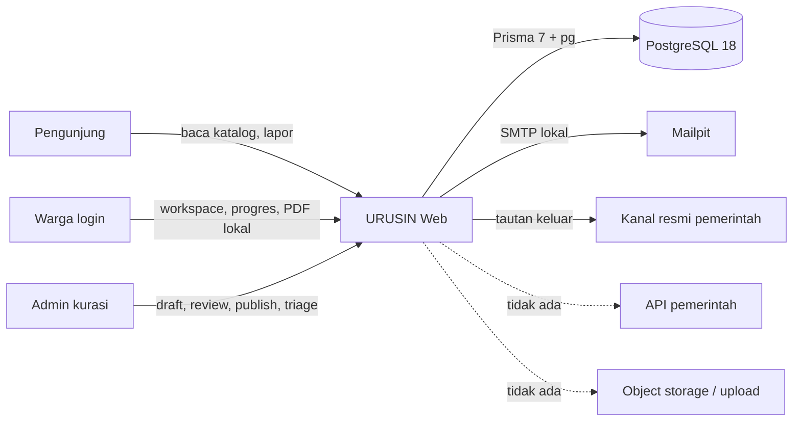
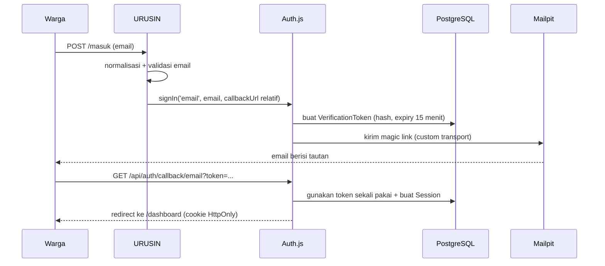
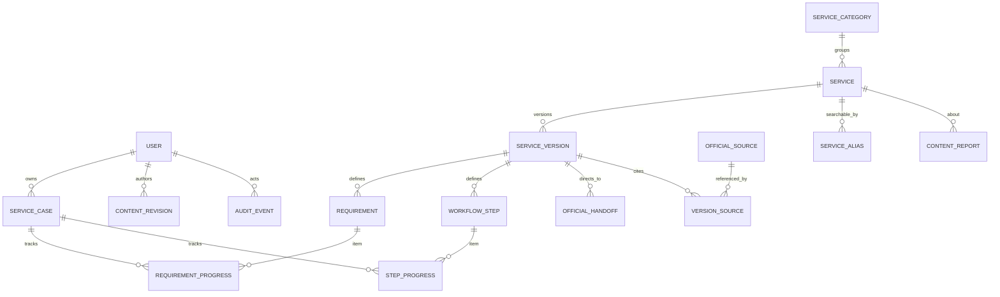

# Architecture — URUSIN MVP v1.1

**Status:** DRAFT — mengikuti `IMPLEMENTATION_PLAN.md`  
**Tanggal:** 2026-11-23  
**Gaya arsitektur:** Modular monolith, Next.js App Router, PostgreSQL, server-first

---

## 1. Tujuan arsitektur

URUSIN harus:

1. Membantu warga menemukan, menyiapkan, dan memantau pengurusan administrasi secara mandiri.
2. Menjaga batas kewenangan: tidak menerbitkan, mengajukan, atau mengklaim status instansi pemerintah.
3. Meminimalkan data pribadi: tidak menyimpan identitas, dokumen, atau isi surat.
4. Aman sejak desain: otorisasi per objek, validasi server, least privilege, audit.
5. Cepat dan ringan untuk pengguna mobile dengan literasi digital beragam.
6. Sederhana untuk dipelihara: satu aplikasi, satu database, tanpa infrastruktur tambahan.

Prinsip:

- **Server-first**: server component dan Server Actions menjadi default; JavaScript client minimal.
- **Fail closed**: jika data/konfigurasi tidak valid, jangan tampilkan atau jangan jalankan.
- **Immutable published content**: prosedur terbit adalah snapshot yang tidak boleh berubah.
- **Object ownership**: login saja tidak cukup; setiap resource warga diperiksa kepemilikannya.
- **Data minimization**: jika tidak perlu disimpan, jangan disimpan.
- **No silent failure**: error/loading/empty state eksplisit dan dilaporkan.

---

## 2. Konteks sistem



Yang **tidak** ada:

- API pemerintah, bot, scraping login, kredensial instansi.
- Upload dokumen, object storage, tabel file.
- Microservices, Redis, queue, Elasticsearch, Kubernetes.
- Analytics/pihak ketiga, AI chatbot, payment gateway.

---

## 3. Modular monolith

### 3.1 Modul

| Modul       | Tanggung jawab                                                     | Tidak boleh                                        |
| ----------- | ------------------------------------------------------------------ | -------------------------------------------------- |
| `auth`      | Konfigurasi Auth.js, adapter, email provider, session, guard, RBAC | Mengakses case warga selain lewat helper ownership |
| `catalog`   | Katalog publik, detail, pencarian, sumber, handoff                 | Menampilkan DRAFT/ARCHIVED                         |
| `cases`     | Workspace warga, checklist, langkah, status, version warning       | Menyimpan identitas/dokumen                        |
| `reports`   | Laporan ketidakakuratan, anti-spam                                 | Menyimpan NIK/email pelapor guest                  |
| `admin`     | CRUD draft, review, publish, archive, triage, audit                | Membaca case warga                                 |
| `documents` | Generator PDF client-side                                          | Mengirim data ke server                            |
| `audit`     | AuditEvent/ContentRevision                                         | Menyimpan PII/token/body                           |

### 3.2 Aturan dependensi

```text
app/ (route, page, layout)
  -> modules/*/actions|queries
     -> modules/*/schemas
     -> lib/db, lib/env, lib/logger, lib/security
        -> Prisma generated client
```

- `app/` tidak boleh mengimpor Prisma langsung; selalu lewat modul.
- `modules/catalog` tidak boleh mengimpor `modules/cases`.
- `modules/cases` boleh membaca snapshot katalog lewat query khusus (`cases/queries`), bukan mengubah katalog.
- `components/ui` tidak boleh mengimpor modul domain.
- `lib/*` tidak boleh mengimpor `modules/*` (menghindari siklus).
- Semua akses database diberi `import "server-only"` pada modul server.

### 3.3 Struktur fitur

Setiap modul berisi:

- `schemas.ts` — Zod schema yang dipakai client dan server.
- `queries.ts` — baca data, select minimal, ownership filter.
- `actions.ts` — Server Action mutasi, validasi + otorisasi + audit.
- `transitions.ts` — state machine domain (case/version/report).
- `*.test.ts` — unit/integration sesuai kebutuhan.

---

## 4. Alur request dan data

### 4.1 Baca (server component)

```text
Request
  -> proxy.ts (redirect halaman terlindungi + header keamanan)
  -> page.tsx / layout.tsx (server component)
  -> requireUser/requireAdmin/ownership helper (jika perlu)
  -> modules/*/queries.ts
  -> Prisma select/include minimal
  -> render React Server Component
```

- Tidak ada data sensitif yang dikirim ke client component.
- Query publik memfilter `Service.lifecycle_status = ACTIVE` dan `ServiceVersion.status = PUBLISHED` serta validasi kelengkapan.
- Query warga selalu `where: { userId: session.user.id, deletedAt: null }`.

### 4.2 Mutasi (Server Action)

```text
Form submit
  -> Next.js Server Action (origin check bawaan)
  -> Zod parse (server)
  -> requireUser/requireAdmin
  -> ownership/version validation
  -> Prisma transaction / upsert
  -> AuditEvent bila administratif
  -> revalidatePath
  -> redirect/return safe message
```

- Server Action tidak menerima `userId` dari client.
- Error internal tidak dikembalikan mentah; gunakan kode error yang aman.
- Tidak ada endpoint REST tambahan pada MVP.

### 4.3 Auth route

```text
POST /api/auth/signin/email
  -> rate limit wrapper
  -> Auth.js CSRF + email flow
  -> custom sendVerificationRequest
  -> Mailpit SMTP (dev/test)
  -> VerificationToken (hashed, one-time, expiry pendek)
```

---

## 5. Autentikasi dan otorisasi

### 5.1 Keputusan auth

- **Auth.js v4 (`next-auth@4.24.15`)** karena stabil dan mendukung Next 16.
- **Email magic link** tanpa password.
- **Custom email provider** yang tidak mengimpor `nodemailer` dan tidak memasang `@auth/core`.
- **Mailpit** sebagai local sink pada development/test.
- **Produksi gagal tertutup** sampai owner menyetujui provider email.
- Session **database**, bukan JWT, agar sesi dapat dicabut dan role selalu dibaca dari DB.

### 5.2 Mengapa bukan v5 beta / bukan nodemailer

- `next-auth@5` masih beta (tidak memenuhi kebijakan versi stabil).
- `@auth/core@0.34.3` (peer v4) memiliki advisory **Critical** (email homoglyph) dan **High** (getToken DoS).
- `nodemailer@7.x` dan `8.x` memiliki banyak advisory; versi aman 10.6.1 berada di luar peer Auth.js.
- `next-auth@4` tidak mereferensikan `@auth/core` pada runtime (sudah diverifikasi dari tarball).
- Custom provider hanya membutuhkan `sendVerificationRequest`; alur token tetap ditangani Auth.js.

Gate wajib Phase 1:

```bash
npm ls @auth/core   # harus kosong
npm ls nodemailer   # harus kosong
```

Jika typecheck memerlukan tipe `@auth/core`, gunakan `skipLibCheck` + type shim lokal. **Jangan** memasang `@auth/core@0.34.3`.

### 5.3 Alur login



Aturan:

- Email dinormalisasi NFKC + trim + lowercase; hanya ASCII; tepat satu `@`.
- `callbackUrl` hanya path relatif same-origin; `//evil.com` dan URL absolut ditolak.
- Token magic link berlaku 15 menit, sekali pakai.
- `Referrer-Policy: no-referrer` pada halaman verifikasi; URL/token/email tidak di log.
- Pesan "cek email" selalu sama (tidak membocorkan apakah email terdaftar).
- Rate limit: per IP dan per hash email.

### 5.4 Session dan cookie

| Properti   | Nilai                                                                          |
| ---------- | ------------------------------------------------------------------------------ |
| Strategi   | Database session                                                               |
| Max age    | 30 hari                                                                        |
| Update age | 24 jam                                                                         |
| Cookie     | HttpOnly, SameSite=Lax, Path=/, Secure di produksi                             |
| Prefix     | `__Secure-`/`__Host-` sesuai Auth.js di produksi                               |
| Rotasi     | Logout menghapus session DB; role change berlaku pada request berikutnya       |
| CSRF       | Auth.js built-in untuk route auth; Server Actions memakai origin check Next.js |

### 5.5 RBAC dan ownership

| Resource          | Guest                 | CITIZEN | ADMIN               |
| ----------------- | --------------------- | ------- | ------------------- |
| Katalog published | read                  | read    | read                |
| Detail published  | read                  | read    | read                |
| Laporan           | create (rate-limited) | create  | triage              |
| Case sendiri      | —                     | CRUD    | —                   |
| Case warga lain   | —                     | —       | **tidak ada akses** |
| Draft/versi admin | —                     | —       | CRUD                |
| Publish/archive   | —                     | —       | ya                  |
| Audit             | —                     | —       | read                |
| Promosi admin     | —                     | —       | CLI server only     |

Aturan implementasi:

- `requireUser()` → redirect `/masuk?callbackUrl=...` untuk halaman; return error aman untuk action.
- `requireAdmin()` → `notFound()`/403 untuk halaman admin.
- `getOwnedCase(caseId, userId)` → `findFirst({ where: { id, userId, deletedAt: null } })`; jika tidak ada → `notFound()` (tidak membocorkan keberadaan).
- Tidak ada query case tanpa filter `userId` kecuali skrip pemeliharaan dengan akses DB langsung.
- Admin tidak memiliki route/action untuk membaca case.

### 5.6 Promosi admin

- Tidak ada endpoint HTTP.
- `scripts/promote-admin.ts` dijalankan di server dengan akses DB.
- Hanya mengubah `User.role` + menulis `AuditEvent`.
- Seed dev boleh membuat admin hanya jika `SEED_ADMIN_EMAIL` di-set dan `NODE_ENV !== 'production'`.
- Tidak ada password default.

### 5.7 Account deletion

- Wajib token email sekali pakai sebelum hapus akun.
- Transaksi: hapus Session/Account/ServiceCase (cascade progress), set `ContentReport.reporter_id = NULL`, nonaktifkan/soft-delete user.
- Admin dengan `ContentRevision` tidak boleh hard-delete; gunakan `deleted_at`/`is_active`.
- Tidak menyimpan email di audit setelah penghapusan.

---

## 6. Model domain dan invariant

### 6.1 Entity inti



Detail kolom mengikuti `ERD_URUSIN_v1.md`. Tambahan teknis yang diusulkan:

- `User.name` (map ke `display_name`), `emailVerified` (map ke `email_verified_at`), `image` untuk adapter Auth.js.
- `AuditEvent.detail` (sanitized, maks. 500 karakter) — **menunggu persetujuan owner**.
- `ContentReport.updated_at`/`resolved_at` — opsional, menunggu persetujuan.

### 6.2 ServiceVersion state machine

```text
DRAFT -> IN_REVIEW -> PUBLISHED -> ARCHIVED
           |             |
           +--> DRAFT    +--> (tidak diedit; buat versi baru)
```

Aturan:

- Hanya satu `PUBLISHED` per `Service` (partial unique index).
- Publish baru mengarsipkan versi lama dalam satu transaksi.
- Versi `PUBLISHED`/`ARCHIVED` tidak boleh diubah kontennya.
- Versi yang direferensikan `ServiceCase` tidak boleh dihapus.
- Takedown: `PUBLISHED -> ARCHIVED`; case historis menampilkan warning.

### 6.3 ServiceCase state machine

```text
IN_PROGRESS -> USER_MARKED_DONE -> ARCHIVED
      +--------------------------> ARCHIVED
```

- Semua status adalah tindakan pengguna, bukan status instansi.
- Soft delete (`deleted_at`) untuk arsip/hapus; query default mengecualikan.
- Case menyimpan snapshot `service_version_id`.

### 6.4 Publish transaction

```text
BEGIN
  1. Muat versi kandidat; pastikan status IN_REVIEW dan service cocok
  2. Validasi:
     - >=1 OfficialSource via VersionSource
     - verified_at dan verified_by_id terisi
     - >=1 OfficialHandoff valid (http/https, domain allowlist)
     - >=1 Requirement dan >=1 WorkflowStep
     - reviewer_id tercatat
  3. UPDATE versi PUBLISHED lama -> ARCHIVED
  4. UPDATE kandidat -> PUBLISHED, published_at = now()
  5. INSERT ContentRevision (PUBLISH) + AuditEvent
COMMIT
```

- Unique index mencegah dua PUBLISHED jika terjadi race.
- Error validasi dikembalikan sebagai pesan aman; detail hanya di log server.
- Tidak ada operasi publish parsial.

### 6.5 Progress lintas versi

- `RequirementProgress`/`StepProgress` hanya boleh menunjuk item dari versi case.
- Validasi di server action dalam transaksi:
  1. `case = findFirst({ id, userId, deletedAt: null })`
  2. `item = findUnique({ id })`
  3. `item.serviceVersionId === case.serviceVersionId` atau tolak.
  4. Upsert dengan unique `(case_id, item_id)`.
- FK database tidak cukup; integration test wajib menembak item versi lain.
- Trigger database untuk invariant ini dipertimbangkan sebagai defense-in-depth, tetapi bukan blocker MVP karena semua tulisan melalui server action dan role runtime tidak punya akses langsung ke aplikasi lain.

### 6.6 Version staleness

- Query batch mengambil versi PUBLISHED terbaru untuk service-service dalam dashboard.
- Jika `case.serviceVersionId !== latestPublishedId`, tampilkan banner.
- Tidak ada auto-migrate. Pengguna dapat membuat case baru dari versi terbaru.
- Case lama tetap dapat dibaca meski versinya ARCHIVED.

---

## 7. Database

### 7.1 Prinsip

- PostgreSQL 18.6, UUID PK, timestamp UTC (`timestamptz`).
- Enum tersentralisasi; tidak ada string status bebas.
- Nama kolom snake_case di DB (Prisma `@map`) agar konsisten dengan ERD.
- Soft delete hanya untuk `User`/`ServiceCase`; data lain mengikuti aturan FK.
- Tidak ada tabel file/dokumen.

### 7.2 Role dan privilege

| Role              | Kegunaan            | Privilege                                                      |
| ----------------- | ------------------- | -------------------------------------------------------------- |
| `postgres`        | Superuser container | Hanya init script; tidak dipakai aplikasi                      |
| `urusin_migrator` | Prisma CLI/migrasi  | DDL pada schema `public`, owner objek                          |
| `urusin_app`      | Runtime Prisma      | `SELECT/INSERT/UPDATE/DELETE`, `USAGE` sequence; **tanpa DDL** |

Init script:

1. `CREATE EXTENSION IF NOT EXISTS pg_trgm;`
2. Buat role dari environment (password acak, tidak di-commit).
3. Buat database `urusin`.
4. `ALTER DEFAULT PRIVILEGES FOR ROLE urusin_migrator ... GRANT ... TO urusin_app;`
5. Set `statement_timeout` dan `idle_in_transaction_session_timeout` untuk role runtime.

Koneksi:

- Runtime: `DATABASE_URL` → `urusin_app`.
- Migrasi: `MIGRATE_DATABASE_URL` → `urusin_migrator` (dibaca `prisma.config.ts`).
- Bind Compose ke `127.0.0.1:5433`.
- Produksi: TLS wajib; jangan set `rejectUnauthorized: false`.

### 7.3 Index dan constraint wajib

Lihat `IMPLEMENTATION_PLAN.md` §10.1. Ringkasan:

- `User(email)` unique (lowercase).
- `Service(code)`, `Service(slug)` unique; `Service(category_id, lifecycle_status)`.
- `ServiceVersion(service_id, version_number)` unique; `(service_id, status)`.
- Partial unique `ServiceVersion(service_id) WHERE status='PUBLISHED'`.
- `ServiceAlias(service_id, lower(phrase))` unique + trigram.
- `Requirement`/`WorkflowStep` index `(service_version_id, sort_order)`.
- `ServiceCase(user_id, status, started_at)`.
- `RequirementProgress(case_id, requirement_id)` unique.
- `StepProgress(case_id, workflow_step_id)` unique.
- `ContentReport(status, created_at)`.
- FTS/trigram GIN index.

### 7.4 Isolation dan transaksi

- Default PostgreSQL `READ COMMITTED`.
- Publish: transaksi + partial unique index; tangani `P2002` dengan pesan "versi lain baru saja dipublikasikan".
- Progress upsert: transaksi singkat; unique constraint menjamin idempotensi.
- Account deletion: satu transaksi.
- Tidak ada transaksi panjang yang menahan lock saat render UI.

### 7.5 Migrasi

- Prisma Migrate; file SQL di-commit.
- Migrasi manual untuk partial index, expression index, extension, role/privilege (role/privilege di init script, bukan migrasi aplikasi).
- `prisma migrate dev` tidak lagi auto-generate/seed di Prisma 7; script:
  - `db:generate` → `prisma generate`
  - `db:migrate` → `prisma migrate dev`
  - `db:deploy` → `prisma migrate deploy`
  - `db:seed` → `prisma db seed`
- CI menjalankan `migrate deploy` pada database kosong.
- Perubahan schema wajib disertai test dan pembaruan ERD/diagram.

### 7.6 Backup dan retensi

- `scripts/backup.sh`: `pg_dump --format=custom` ke volume lokal, retensi N hari.
- `scripts/restore-test.sh`: restore ke database `urusin_restore_test`, jalankan smoke query.
- Retensi data:
  - Case soft-deleted dipurge oleh `scripts/purge-deleted.ts` setelah 30 hari (default, dapat diubah owner).
  - Laporan disimpan untuk kualitas konten; `reporter_id` null setelah user dihapus.
  - Audit administratif disimpan minimal/pseudonim.
- Backup produksi dan enkripsi at-rest adalah keputusan deployment owner.

---

## 8. Pencarian

### 8.1 Strategi

1. Normalisasi input: trim, lowercase, NFKC, maks. 80 karakter; tolak karakter kontrol.
2. Exact match `Service.code`/`Service.slug`/`Service.title` → skor tertinggi.
3. Alias (`ServiceAlias.phrase`) → skor berikutnya.
4. FTS `to_tsvector('indonesian', title/summary)` dengan `websearch_to_tsquery`.
5. Fuzzy fallback `similarity()`/`%` dengan `pg_trgm` (threshold ~0.25–0.3).
6. Filter hanya `Service.ACTIVE` + `ServiceVersion.PUBLISHED` valid.
7. Limit 20; urutkan skor lalu judul; pagination offset sederhana.

### 8.2 Query

- Gunakan `Prisma.sql` tagged template; **tidak** `$queryRawUnsafe`.
- Tidak ada LLM/generasi otomatis syarat.
- Alias adalah bantuan pencarian, bukan klaim resmi.
- Empty state: "Belum ada layanan yang cocok. Coba kata lain atau lihat kategori."

### 8.3 Index

- GIN trigram pada `Service.title`, `ServiceAlias.phrase`.
- GIN FTS pada `Service.title`, `ServiceVersion.summary`.
- Jika konfigurasi `indonesian` tidak tersedia, gunakan `simple` + alias curation; catat ADR.

---

## 9. Batas dokumen dan PDF

- Generator PDF adalah **client component** yang di-import dinamis.
- Input:
  - data publik dari versi yang sudah dirender server;
  - pilihan checklist pengguna (jika ada) tetap di memori.
- Tidak ada:
  - upload,
  - simpan file di server,
  - localStorage/IndexedDB,
  - autosave,
  - pengiriman form ke endpoint.
- Output:
  - PDF berisi teks, metadata bahasa Indonesia, disclaimer non-resmi;
  - tanpa NIK/identitas default;
  - nama file generik (`lembar-persiapan-urusin.pdf`).
- Template surat pribadi tidak termasuk MVP kecuali owner menyetujui template spesifik.
- Jika input sensitif ditambahkan kelak: tetap client-only, clear state on unmount, no network, no persistence.

---

## 10. Keamanan aplikasi

### 10.1 Threat model ringkas

| Ancaman                 | Contoh                        | Kontrol                                               |
| ----------------------- | ----------------------------- | ----------------------------------------------------- |
| Broken access control   | User A membuka case B         | Ownership filter + 404; integration test BOLA         |
| BOLA via ID             | Ubah `caseId` di URL/action   | Re-query dengan `userId`; jangan percaya ID           |
| Cross-version tampering | Tandai requirement versi lain | Validasi `serviceVersionId` dalam transaksi           |
| Auth bypass             | Akses `/admin`                | Guard server; proxy hanya redirect; role dari DB      |
| Session theft           | Cookie dicuri                 | HttpOnly, Secure, SameSite=Lax, session DB, logout    |
| CSRF                    | Aksi mutasi dari situs lain   | Auth.js CSRF; Server Actions origin check; SameSite   |
| XSS                     | Judul/laporan berisi script   | React escaping; tanpa dangerouslySetInnerHTML; CSP    |
| SQL injection           | Query pencarian               | Prisma parameterized; `Prisma.sql`; test payload      |
| Open redirect           | `callbackUrl=https://evil`    | Hanya path relatif same-origin                        |
| SSRF                    | URL sumber/handoff            | Tidak ada fetch server-side; validasi http/https      |
| Malicious link          | `javascript:` di handoff      | Skema allowlist; validasi publish                     |
| Enumeration             | Cek email terdaftar           | Pesan seragam; rate limit                             |
| Brute force/spam        | Login/laporan                 | Rate limit + honeypot                                 |
| Data leakage in logs    | Email/token di log            | Logger allowlist; redaction; test                     |
| Sensitive storage       | NIK di DB/localStorage        | Schema tanpa kolom; validasi laporan; PDF client-only |
| Dependency supply chain | Package berbahaya/CVE         | Pin, lockfile, audit, OSV/Trivy                       |
| Privilege escalation    | Citizen jadi admin            | Role hanya via CLI/DB; tidak ada endpoint             |
| PII di URL              | Email di magic link           | `no-referrer`, tanpa log; keputusan owner             |

### 10.2 Header keamanan

Diterapkan di `next.config.ts` dan/atau `proxy.ts`:

```text
Content-Security-Policy:
  default-src 'self';
  script-src 'self' 'nonce-<random>' 'strict-dynamic';
  style-src 'self' 'unsafe-inline';
  img-src 'self' data:;
  font-src 'self';
  connect-src 'self';
  object-src 'none';
  base-uri 'self';
  form-action 'self';
  frame-ancestors 'none';
  upgrade-insecure-requests (produksi)
X-Content-Type-Options: nosniff
Referrer-Policy: strict-origin-when-cross-origin
Permissions-Policy: camera=(), microphone=(), geolocation=(), payment=()
Cross-Origin-Opener-Policy: same-origin
Cross-Origin-Resource-Policy: same-origin
X-Frame-Options: DENY
Strict-Transport-Security: max-age=31536000 (hanya HTTPS produksi)
```

Catatan:

- `style-src 'unsafe-inline'` diperlukan untuk style inline Radix/Tailwind tertentu; script tetap nonce.
- CSP nonce diimplementasikan di Phase 5; sebelum itu gunakan `Content-Security-Policy-Report-Only` dan catat.
- Tidak ada domain eksternal pada `script-src`/`connect-src`; tautan resmi adalah navigasi, bukan fetch.
- `poweredByHeader: false`.

### 10.3 Input validation

- Zod di client dan server; server selalu parse ulang.
- Email: NFKC, lowercase, ASCII, tepat satu `@`, maks. 254.
- URL: `http`/`https`, tanpa credentials, maks. 2048; hostname wajib; tolak `javascript:`, `data:`, `file:`, `localhost`/private IP untuk sumber resmi (kecuali test fixture yang diizinkan).
- Domain allowlist handoff dari env; publish ditolak jika domain tidak diizinkan.
- Slug: `^[a-z0-9]+(?:-[a-z0-9]+)*$`, maks. 80.
- Kode: `^[A-Z]{2,4}-\d{2}$`.
- Pesan laporan: 20–1000 karakter; tolak 16 digit berurutan.
- Body size limit Server Actions 100 KB; tidak ada multipart/upload.
- Tidak ada rich text/HTML input; semua teks dirender sebagai teks.

### 10.4 Output dan CSP

- React escaping default.
- Tidak ada `dangerouslySetInnerHTML`.
- Tautan eksternal: `target="_blank" rel="noopener noreferrer"`, tampilkan hostname.
- PDF: teks via pdf-lib; tidak menyisipkan HTML.
- Error page tidak menampilkan stack/query.

### 10.5 Rate limiting

Implementasi MVP: in-memory fixed window.

| Aksi                            | Limit usulan  |
| ------------------------------- | ------------- |
| Kirim magic link per IP         | 5 / 15 menit  |
| Kirim magic link per hash email | 3 / 15 menit  |
| Buat laporan per IP             | 3 / jam       |
| Mutasi case per user            | 60 / menit    |
| Login callback                  | 10 / 15 menit |

- Key = SHA-256(IP + route + optional user id); tidak menyimpan IP mentah.
- IP diambil dari trusted proxy header hanya jika deployment di belakang reverse proxy; jika tidak, gunakan fallback lokal.
- Keterbatasan: tidak berlaku lintas instance. Deployment MVP harus single-instance; scale-out memerlukan shared store (di luar scope).
- Honeypot + timing check pada laporan guest.

### 10.6 Logging dan audit

Structured log JSON:

```json
{
  "ts": "...",
  "level": "info",
  "event": "case.progress.update",
  "requestId": "...",
  "userId": "...",
  "outcome": "ok",
  "durationMs": 12
}
```

Dilarang:

- email, token, cookie, Authorization header;
- isi laporan/pesan;
- query pencarian mentah;
- body form;
- NIK/identitas.

AuditEvent/ContentRevision:

- hanya actor id, entity type/id, action, timestamp, detail sanitized;
- tidak ada PII/token/body;
- admin audit read-only.

### 10.7 Secrets

- `.env` di `.gitignore`; `.env.example` tanpa nilai nyata.
- Validasi env saat startup; aplikasi gagal jika secret lemah/hilang.
- `NEXTAUTH_SECRET` minimal 32 byte acak.
- Tidak ada secret di client bundle; `NEXT_PUBLIC_*` hanya untuk nilai non-sensitif.
- Rotasi secret = invalidasi sesi; dokumentasikan.

---

## 11. Performa

### 11.1 Query

- Select field minimal; hindari `SELECT *`.
- Dashboard: satu query case + include versi/service + agregasi progress; tidak ada loop query.
- Case detail: satu query case + requirements/steps/handoffs/progress; map di memori.
- Katalog: satu query service + published version + kategori; detail satu query dengan include.
- Search: satu raw SQL dengan CTE/ranking.
- Pagination admin 20–50.
- Uji query count pada integration test; deteksi N+1.
- `EXPLAIN (ANALYZE, BUFFERS)` untuk query kritis; catat di test evidence.

### 11.2 Render dan JavaScript

- Server components default.
- Client components hanya: form login, checklist toggle jika perlu optimistic UI, PDF generator, komponen interaktif shadcn.
- Tidak ada library chart/state global/analytics.
- Font sistem (tanpa Google Fonts) untuk privasi dan performa.
- Ikon Lucide tree-shaken.
- `next/image` hanya untuk aset lokal; tidak ada remote image.
- Turbopack default Next 16; `output: 'standalone'` untuk Docker.

### 11.3 Caching

- Tidak ada cache aplikasi/Redis di MVP.
- Halaman publik dinamis; jika perlu, `Cache-Control` pendek + `stale-while-revalidate` setelah data stabil.
- Jangan cache halaman warga/admin.
- Jangan cache data yang mengandung sesi/PII.

### 11.4 Target

- p75 LCP <= 2.5s pada lingkungan pengukuran lokal yang didefinisikan (build produksi, Chromium, throttle), bukan klaim produksi.
- CLS < 0.1; INP wajar; tidak ada layout shift dari font/gambar.
- Ukuran JS publik diukur dan dicatat; tidak ada anggaran arbitrer sebelum baseline.

---

## 12. Aksesibilitas dan UX

- Mobile-first; target sentuh >=44px; layout 320–1440px.
- `lang="id"`; heading hierarkis; skip link.
- Form: label eksplisit, `aria-describedby` untuk error, error summary, autocomplete sesuai konteks.
- Status tidak hanya warna; teks + ikon.
- Kontras WCAG 2.2 AA (4.5:1 teks normal).
- Fokus terlihat; navigasi keyboard; tidak ada focus trap.
- `prefers-reduced-motion` dihormati.
- Loading/error/empty state eksplisit.
- Bahasa Indonesia jelas; hindari jargon; jelaskan kapan harus ke instansi.
- Disclaimer "URUSIN bukan situs resmi pemerintah" di footer dan halaman detail.
- Handoff CTA jelas: "Lanjut ke kanal resmi" + nama instansi + peringatan keluar aplikasi.
- Tidak ada dark pattern/premium.

---

## 13. Observability dan operasi

### 13.1 Log dan health

- Structured JSON log ke stdout.
- `GET /api/health`? Tidak ada route API tambahan pada MVP; healthcheck dapat berupa halaman `/` atau endpoint internal yang dilindungi. Jika ditambahkan, hanya status `ok` + versi build, tanpa detail DB/PII.
- Docker healthcheck untuk DB dan app.
- Tidak ada APM/SaaS.

### 13.2 Deployment lokal

```text
Host Windows
  ├─ npm run dev (Next.js 127.0.0.1:3000)
  ├─ docker compose: postgres 127.0.0.1:5433
  └─ docker compose: mailpit 127.0.0.1:1025/8025
```

- Semua port bind loopback.
- Tidak ada reverse proxy di lokal.
- `.env` lokal; `.env.example` di repo.

### 13.3 Deployment produksi (pilot)

- Docker image app + PostgreSQL terkelola/self-hosted + reverse proxy TLS.
- Environment terpisah; secret manager/ENV, bukan file repo.
- HTTPS wajib; HSTS; cookie Secure.
- Backup terjadwal + restore test.
- Monitoring/log aggregation keputusan owner (biaya).
- Rate limit single-instance; scale-out perlu shared store.
- Review UU PDP/PSE dan kebijakan retensi sebelum publik.

---

## 14. Architecture Decision Records (ADR)

### ADR-001 — Modular monolith Next.js

- **Keputusan:** satu aplikasi Next.js App Router + PostgreSQL.
- **Alasan:** scope kecil, tim kecil, deploy sederhana, tidak perlu microservices.
- **Konsekuensi:** batas modul dijaga lewat konvensi dan review; scaling vertikal.

### ADR-002 — Auth.js v4 stabil + custom email provider

- **Keputusan:** `next-auth@4.24.15`, magic link, custom `sendVerificationRequest`, Mailpit lokal.
- **Alasan:** v5 beta; `@auth/core@0.34.3` Critical; `nodemailer` 7/8 rentan.
- **Konsekuensi:** tidak ada email produksi sampai owner memilih provider; harus menjaga kompatibilitas tipe Auth.js v4.

### ADR-003 — Prisma 7 + driver adapter + ESM

- **Keputusan:** `prisma-client` generator, output `src/generated/prisma`, `@prisma/adapter-pg`, `pg`.
- **Alasan:** Prisma 7 stable; Rust-free; driver adapter wajib.
- **Konsekuensi:** `type: module`; generated client tidak di-commit; adapter Auth.js v4 perlu wrapper/validasi tipe.

### ADR-004 — Published version immutable

- **Keputusan:** snapshot versi; publish transaksional; partial unique index; versi baru untuk perubahan.
- **Alasan:** progres warga tidak boleh berubah diam-diam; audit konten.
- **Konsekuensi:** admin tidak bisa edit in-place; perlu alur versi baru/takedown.

### ADR-005 — Server Actions, bukan REST

- **Keputusan:** mutasi lewat Server Actions; route handler hanya Auth.js.
- **Alasan:** mengurangi permukaan API, validasi terpusat, CSRF/origin handling Next.
- **Konsekuensi:** tidak ada API publik untuk integrasi; jika dibutuhkan kelak, buat endpoint terpisah dengan kontrol setara.

### ADR-006 — PostgreSQL FTS + pg_trgm

- **Keputusan:** pencarian deterministik tanpa LLM/mesin eksternal.
- **Alasan:** zero-cost, data kecil, kontrol kualitas.
- **Konsekuensi:** kualitas bergantung alias/konfigurasi bahasa; perlu kurasi.

### ADR-007 — PDF client-side

- **Keputusan:** `pdf-lib` di browser; tanpa simpan file.
- **Alasan:** input sensitif tidak boleh ke server.
- **Konsekuensi:** bundle client bertambah saat dipakai (dynamic import); tidak ada riwayat dokumen.

### ADR-008 — Database least privilege

- **Keputusan:** role migrator dan runtime terpisah.
- **Alasan:** mengurangi dampak SQL injection/bug; runtime tanpa DDL.
- **Konsekuensi:** setup Compose lebih kompleks; grant default privileges wajib.

### ADR-009 — Rate limit in-memory

- **Keputusan:** fixed window in-memory untuk MVP.
- **Alasan:** tanpa Redis; satu instance.
- **Konsekuensi:** tidak efektif multi-instance; dokumentasikan dan upgrade sebelum scale-out.

### ADR-010 — Tanpa service worker/PWA offline

- **Keputusan:** web responsif; manifest opsional; tanpa cache offline.
- **Alasan:** menghindari cache data pribadi; offline bukan tujuan MVP.
- **Konsekuensi:** tidak installable/offline penuh; dapat ditambahkan dengan desain cache aman.

### ADR-011 — Guest checklist ditunda

- **Keputusan:** guest hanya katalog; progres memerlukan login.
- **Alasan:** ERD tidak punya case guest; localStorage berisiko; scope MVP.
- **Konsekuensi:** CTA login; jika owner ingin guest checklist, perlu desain terpisah.

### ADR-012 — Audit detail sanitized (usulan)

- **Keputusan:** tambah `AuditEvent.detail` maks. 500 karakter, tanpa PII.
- **Alasan:** audit tanpa detail kurang berguna.
- **Konsekuensi:** perubahan ERD; harus disetujui owner; sanitization test.

---

## 15. Evolusi dan non-goals

### 15.1 Jalur evolusi yang aman

- Auth.js v5 stabil → migrasi dengan test penuh.
- Shared rate-limit store → jika deployment multi-instance.
- 2FA admin → sebelum admin dipakai luas.
- Monitoring produksi → setelah owner menyetujui biaya.
- PWA offline → hanya dengan desain cache yang tidak menyimpan PII.
- Layanan pajak/NIB → fase berikutnya setelah validasi, bukan MVP.

### 15.2 Non-goals yang dijaga

- Tidak ada integrasi pemerintah.
- Tidak ada upload/persistensi dokumen identitas.
- Tidak ada marketplace/pembayaran.
- Tidak ada AI/chatbot.
- Tidak ada data warga nyata di development.
- Tidak ada klaim status instansi.

---

## 16. Referensi

- `docs/PRD_URUSIN_v1.md`
- `docs/ERD_URUSIN_v1.md`
- `docs/IMPLEMENTATION_PLAN.md`
- `docs/DEPENDENCY_SECURITY.md`
- `docs/TEST_STRATEGY.md`
- `AGENTS_URUSIN_v1.1.md`
