# Entity Relationship Diagram (ERD) — URUSIN MVP

**Versi:** 1.0 — logical schema untuk PostgreSQL + Prisma  
**Referensi:** `PRD_URUSIN_v1.md`  
**Prinsip:** katalog terverifikasi, versi workflow immutable, progres mandiri milik pengguna, audit admin, minimisasi data pribadi.

## 1. ERD (Mermaid)

Diagram berikut dapat dirender langsung oleh editor Markdown yang mendukung Mermaid.

```mermaid
erDiagram
    USER ||--o{ SERVICE_CASE : owns
    USER ||--o{ CONTENT_REPORT : submits
    USER ||--o{ CONTENT_REVISION : authors
    USER ||--o{ AUDIT_EVENT : acts

    SERVICE_CATEGORY ||--o{ SERVICE : groups
    SERVICE ||--o{ SERVICE_VERSION : versions
    SERVICE_VERSION ||--o{ VERSION_SOURCE : cites
    OFFICIAL_SOURCE ||--o{ VERSION_SOURCE : referenced_by
    SERVICE_VERSION ||--o{ REQUIREMENT : defines
    SERVICE_VERSION ||--o{ WORKFLOW_STEP : defines
    SERVICE ||--o{ SERVICE_ALIAS : searchable_by
    SERVICE_VERSION ||--o{ OFFICIAL_HANDOFF : directs_to
    SERVICE_VERSION ||--o{ SERVICE_CASE : selected_in
    SERVICE_VERSION ||--o{ CONTENT_REVISION : reviewed_in

    SERVICE_CASE ||--o{ REQUIREMENT_PROGRESS : tracks
    REQUIREMENT ||--o{ REQUIREMENT_PROGRESS : item
    SERVICE_CASE ||--o{ STEP_PROGRESS : tracks
    WORKFLOW_STEP ||--o{ STEP_PROGRESS : item
    SERVICE ||--o{ CONTENT_REPORT : about

    USER {
      uuid id PK
      string email UK
      string display_name "nullable"
      string role "CITIZEN | ADMIN"
      datetime email_verified_at "nullable"
      datetime created_at
      datetime deleted_at "nullable"
    }
    SERVICE_CATEGORY {
      uuid id PK
      string slug UK
      string name
      int sort_order
    }
    SERVICE {
      uuid id PK
      uuid category_id FK
      string code UK
      string slug UK
      string title
      string lifecycle_status "ACTIVE | RETIRED"
      datetime created_at
    }
    SERVICE_ALIAS {
      uuid id PK
      uuid service_id FK
      string phrase
    }
    SERVICE_VERSION {
      uuid id PK
      uuid service_id FK
      int version_number
      string status "DRAFT | IN_REVIEW | PUBLISHED | ARCHIVED"
      string summary
      string eligibility_note "nullable"
      datetime verified_at "nullable"
      uuid verified_by_id FK "nullable"
      datetime published_at "nullable"
      datetime created_at
    }
    OFFICIAL_SOURCE {
      uuid id PK
      string agency_name
      string title
      string url
      datetime last_checked_at
    }
    VERSION_SOURCE {
      uuid service_version_id FK
      uuid official_source_id FK
      string evidence_note "nullable"
    }
    REQUIREMENT {
      uuid id PK
      uuid service_version_id FK
      string title
      string guidance
      string condition_note "nullable"
      int sort_order
      boolean is_required
    }
    WORKFLOW_STEP {
      uuid id PK
      uuid service_version_id FK
      string title
      string guidance
      string step_kind "PREPARE | VISIT | HANDOFF | FOLLOWUP"
      int sort_order
    }
    OFFICIAL_HANDOFF {
      uuid id PK
      uuid service_version_id FK
      string label
      string official_url
      string channel_type "WEB | PHYSICAL | OTHER"
      string caveat "nullable"
    }
    SERVICE_CASE {
      uuid id PK
      uuid user_id FK
      uuid service_version_id FK
      string status "IN_PROGRESS | USER_MARKED_DONE | ARCHIVED"
      datetime started_at
      datetime completed_at "nullable"
      datetime deleted_at "nullable"
    }
    REQUIREMENT_PROGRESS {
      uuid id PK
      uuid case_id FK
      uuid requirement_id FK
      boolean is_ready
      datetime updated_at
    }
    STEP_PROGRESS {
      uuid id PK
      uuid case_id FK
      uuid workflow_step_id FK
      string status "NOT_STARTED | IN_PROGRESS | USER_MARKED_DONE"
      datetime updated_at
    }
    CONTENT_REPORT {
      uuid id PK
      uuid service_id FK
      uuid reporter_id FK "nullable"
      string issue_type
      string message
      string status "OPEN | REVIEWING | RESOLVED | REJECTED"
      datetime created_at
    }
    CONTENT_REVISION {
      uuid id PK
      uuid service_version_id FK
      uuid author_id FK
      uuid reviewer_id FK "nullable"
      string action "SUBMIT | APPROVE | REJECT | PUBLISH | ARCHIVE"
      string note "nullable"
      datetime created_at
    }
    AUDIT_EVENT {
      uuid id PK
      uuid actor_id FK "nullable"
      string entity_type
      uuid entity_id
      string action
      datetime created_at
    }
```



**Catatan Mermaid:** `verified_by_id` dan `reviewer_id` juga mereferensikan `USER.id`, tetapi relasi tambahan sengaja tidak digambar agar diagram terbaca; tambahkan FK eksplisit dalam Prisma. `VERSION_SOURCE` adalah tabel junction dengan primary key komposit (`service_version_id`, `official_source_id`). Untuk `USER` autentikasi via Auth.js, tabel adapter terkait (misalnya `Account`, `Session`, `VerificationToken`) mengikuti adapter yang dipilih, bukan domain inti diagram ini.

## 2. Kamus data dan tanggung jawab

| Tabel | Tanggung jawab | Aturan penting |
|---|---|---|
| `User` | Login dan hak akses | Email unik; default CITIZEN; jangan kumpulkan NIK |
| `ServiceCategory` | Kategori KTP, KK, SIM | Slug unik |
| `Service` | Identitas skenario layanan (KTP-02, KK-01) | `code` dan `slug` unik; judul bukan versi prosedur |
| `ServiceAlias` | Sinonim dan bahasa awam | Index pencarian; no duplicate normalized phrase per service |
| `ServiceVersion` | Snapshot prosedur yang direview | UNIQUE (`service_id`, `version_number`); published immutable |
| `OfficialSource` | Identitas rujukan resmi | URL + instansi + tanggal terakhir dicek |
| `VersionSource` | Bukti keterkaitan sumber-versi | Composite PK dan minimum satu sumber untuk versi terbit |
| `Requirement` | Item checklist untuk satu versi | Urut, syarat kondisional harus jelas; tidak menyimpan berkas |
| `WorkflowStep` | Tahap mandiri pengurusan | `step_kind` untuk UX, bukan status resmi |
| `OfficialHandoff` | Link/kanal resmi yang diverifikasi | URL dibatasi http/https dan daftar domain tepercaya sesuai kebijakan review |
| `ServiceCase` | Satu pengurusan yang dipilih warga | Snapshot `service_version_id`; case hanya milik `user_id` |
| `RequirementProgress` | Centang syarat per case | UNIQUE (`case_id`, `requirement_id`) |
| `StepProgress` | Progres tahap per case | UNIQUE (`case_id`, `workflow_step_id`) |
| `ContentReport` | Aduan prosedur usang | Pesan dibatasi panjangnya; instruksi jangan kirim NIK/data sensitif |
| `ContentRevision` | Alur editorial | Mencatat submit, approve, reject, publish, archive |
| `AuditEvent` | Aktivitas administrasi yang perlu audit | Jangan log data pribadi, token, atau isi formulir |

## 3. Relasi dan invariants domain

1. `ServiceCategory (1) -> (N) Service`.
2. `Service (1) -> (N) ServiceVersion`; hanya ada **maksimum satu versi PUBLISHED aktif** per service (tegakkan dengan transaksi dan, bila perlu, partial unique index di migration SQL).
3. `ServiceVersion (1) -> (N) Requirement`, `WorkflowStep`, `OfficialHandoff`.
4. `ServiceVersion (M) <-> (N) OfficialSource` melalui `VersionSource`.
5. `User (1) -> (N) ServiceCase`; `ServiceCase (N) -> (1) ServiceVersion`.
6. `ServiceCase (1) -> (N) RequirementProgress` dan `StepProgress`.
7. Setiap `RequirementProgress.requirement_id` **HARUS** berasal dari `ServiceCase.service_version_id` yang sama; demikian juga `StepProgress.workflow_step_id`. Periksa dalam transaksi/server logic; FK biasa tidak cukup menjamin kesamaan lintas tabel.
8. Setelah `ServiceVersion` terbit, daftar syarat/step/sumber/handoff tidak dapat diubah secara in-place. Buat versi baru.
9. Penghapusan pengguna harus membersihkan progres dan laporan terkait sesuai kebijakan privasi; audit administratif yang perlu disimpan hanya berbentuk minimal/pseudonim.
10. Admin tidak boleh melihat atau mengubah `ServiceCase` warga tanpa kebutuhan yang sah; RBAC saja tidak cukup—cek **object ownership** untuk setiap endpoint warga.
11. `ContentReport` boleh dari guest (`reporter_id NULL`), perlu anti-spam/rate-limit. Jangan membuat kolom teks bebas untuk NIK/nomor identitas.
12. Setiap published version membutuhkan minimal satu `OfficialSource`, `verified_at`, `verified_by_id`, dan setidaknya satu handoff resmi yang sudah dicek. Ini validasi aplikasi/transaksi, bukan sekadar NOT NULL statis.
13. `ContentRevision.reviewer_id` boleh nullable pada SUBMIT, wajib pada APPROVE/REJECT; hindari admin menyetujui sendiri jika tim punya reviewer kedua (kebijakan opsional, tergantung kapasitas tim).

## 4. Enum dan state transition

### ServiceVersion.status

```text
DRAFT -> IN_REVIEW -> PUBLISHED -> ARCHIVED
            |             |
            +--> DRAFT    +--> (bukan edit; buat versi baru)
```

- Saat versi baru dipublish, versi published sebelumnya ditandai `ARCHIVED` dalam **satu transaksi**, tetapi tetap dapat dibaca untuk case historis.
- Tidak boleh menghapus versi yang masih direferensikan `ServiceCase`.
- Bila sumber ditemukan salah, admin dapat menarik publikasinya; workspace historis harus menampilkan warning.

### ServiceCase.status

```text
IN_PROGRESS -> USER_MARKED_DONE -> ARCHIVED
      +--------------------------> ARCHIVED
```

Semuanya merefleksikan **tindakan pengguna**, bukan status permohonan pemerintah.

## 5. Index, constraint dan desain query

### Mandatory indexes

- `User(email)` unique (normalisasi lowercase sesuai kebutuhan).
- `Service(code)` unique; `Service(slug)` unique; `Service(category_id, lifecycle_status)` index.
- `ServiceVersion(service_id, version_number)` unique; `ServiceVersion(service_id, status)` index.
- `ServiceAlias(service_id, phrase)` unique dan pencarian terindeks.
- `Requirement(service_version_id, sort_order)` dan `WorkflowStep(service_version_id, sort_order)` index; dapat unique order per version jika perlu.
- `ServiceCase(user_id, status, started_at)` index.
- `RequirementProgress(case_id, requirement_id)` unique.
- `StepProgress(case_id, workflow_step_id)` unique.
- `ContentReport(status, created_at)` index.

### Search strategy

- PostgreSQL FTS pada title+summary+alias; `pg_trgm` untuk typo.
- Ranking: exact match code/title > alias > full text > fuzzy fallback. Filter **hanya versi terbit yang layak** untuk katalog publik.
- Normalisasi bahasa Indonesia, synonyms seperti `ktp ilang` → `KTP-02`; tidak gunakan LLM untuk menghasilkan syarat otomatis.

### Query critical path

- Katalog publik: join `Service` + `ServiceVersion` published + kategori + sumber, cache aman bila diperlukan.
- Dashboard: `ServiceCase WHERE user_id = session.user.id`, join snapshot syarat/step + progres.
- Publish: transaction (validasi sumber + reviewer + handoff, archive active, publish candidate) agar tidak ada 2 active versions.
- Update checklist: periksa `case.user_id`, `requirement.service_version_id === case.service_version_id`, lalu upsert progress.

## 6. Data privacy dan batas penyimpanan

### Boleh disimpan

- Email dan nama tampilan opsional akun.
- ID skenario/version, checklist boolean, progres langkah, tanggal aktivitas.
- Sumber resmi, metadata verifikasi, audit administratif sanitasi.
- Laporan ketidakakuratan yang sudah disaring dan dibatasi.

### Dilarang dalam MVP

- NIK, nomor KK, nomor SIM, scan KTP/KK/SIM, tanda tangan, tanggal lahir, alamat detail, surat pribadi, kredensial portal pemerintah.
- Penyimpanan hasil generator surat/draf berisi identitas, termasuk di object storage, database, analytics atau logs.
- Menulis data sensitif di query string/URL, log server, telemetry, event analytics.

Jika pengguna mengetik data personal untuk membuat draf, gunakan form **client-side only**, tidak autosave ke backend atau persistent local storage, generate PDF secara lokal, dan bersihkan state saat selesai. Pada MVP, rekomendasi default adalah hanya membuat checklist/lembar persiapan non-sensitif sampai template disetujui.

## 7. Seed data dan audit sumber

Seed development boleh membuat `ServiceCategory` KTP, KK, SIM dan `Service` 8 kandidat dengan status awal DRAFT. **Jangan** mengarang daftar persyaratan resmi, biaya, tautan handoff, nomor layanan atau masa berlaku. Konten perlu diisi dari sumber yang diverifikasi manual oleh admin sebelum status PUBLISHED.

## 8. Batas implementasi dan referensi agent

- Model menggunakan UUID, timestamp UTC, soft-delete untuk `ServiceCase` bila diperlukan kebijakan retensi.
- Implementasi migrasi Prisma harus sesuai constraint; partial indexes atau check constraints yang tak didukung ORM dibuat dengan SQL migration eksplisit.
- Gunakan enum tersentralisasi; jangan simpan `status` bebas tanpa validasi.
- Diagram ini adalah **logical ERD**. Tabel Auth.js adapter teknis dan detail migrasi bisa ditambahkan dengan ADR tanpa mengubah domain semantics.
- Jangan tambahkan entity pembayaran, upload dokumen, government application status, API integration, atau merchant marketplace pada MVP.

## 9. Peta fitur ke tabel

| Fitur | Tabel |
|---|---|
| Search dan katalog | `ServiceCategory`, `Service`, `ServiceAlias`, `ServiceVersion` |
| Sumber dan verifikasi | `OfficialSource`, `VersionSource`, `ContentRevision`, `AuditEvent` |
| Checklist dan workflow | `Requirement`, `WorkflowStep`, `ServiceCase`, `RequirementProgress`, `StepProgress` |
| Handoff resmi | `OfficialHandoff` |
| Laporan kesalahan | `ContentReport` |
| Autentikasi | `User` dan tabel adapter Auth.js yang disepakati |
| PDF persiapan lokal | **Tidak ada tabel file/dokumen** dalam database |

## 10. Validasi sebelum coding

- Review PRD dan konfirmasi tepatnya alur 6–8 skenario serta sumber primer.
- Buat `schema.prisma` dengan FK + unique constraints sesuai ini.
- Tulis test terhadap ownership, cross-version item tampering, one-active-version publishing, archive/migration warning, report rate limit, dan penghapusan data.
- Buat diagram ulang otomatis bila schema berubah, sehingga diagram Markdown dan database tidak drift.
